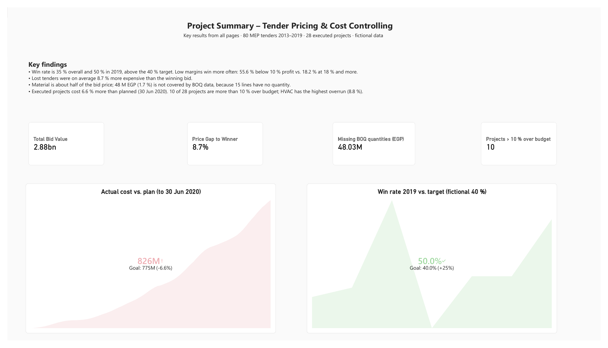
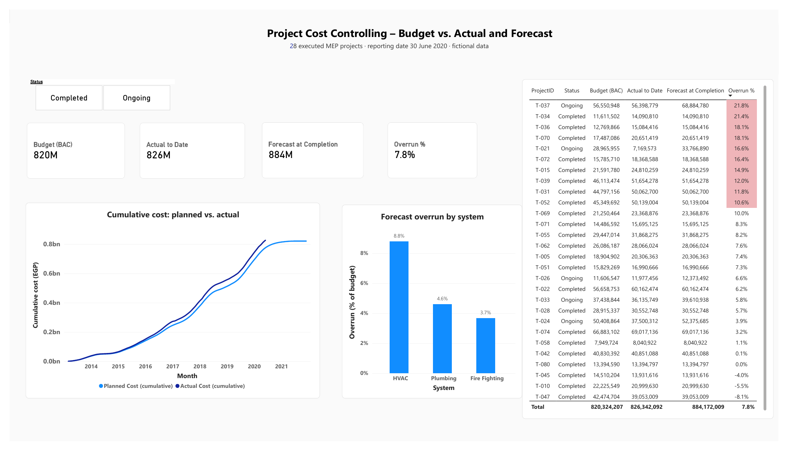
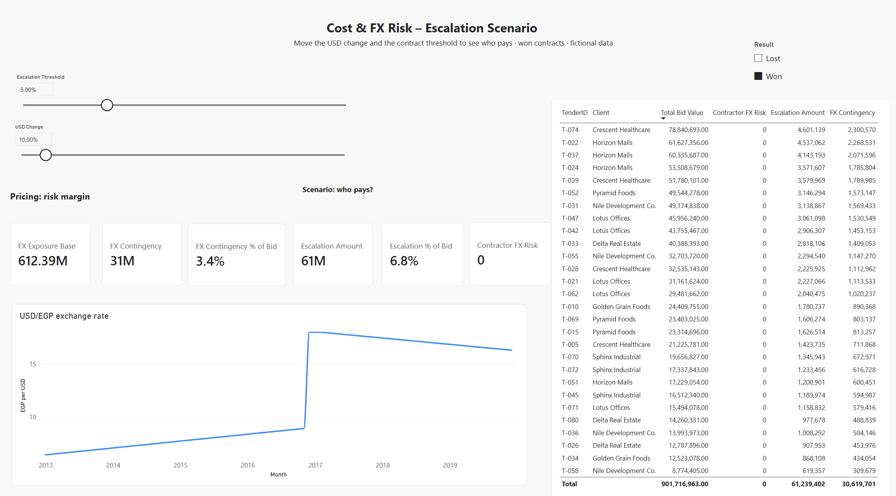
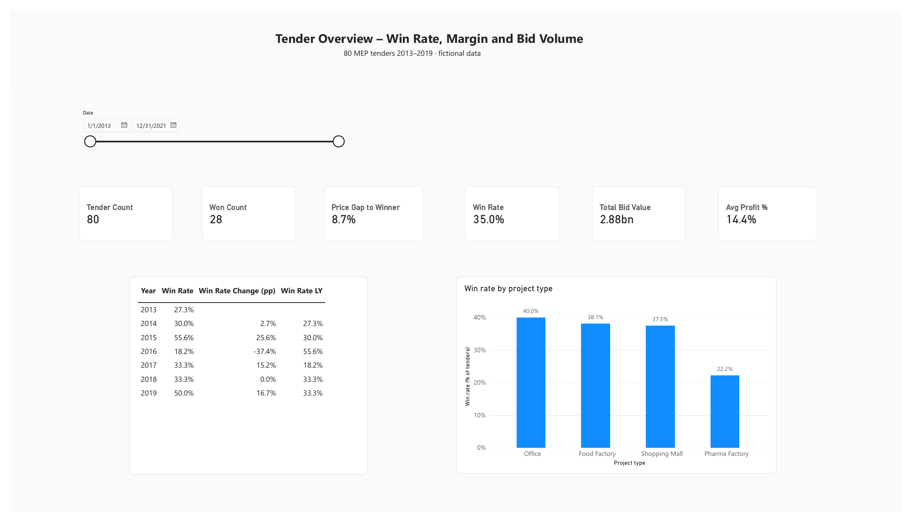
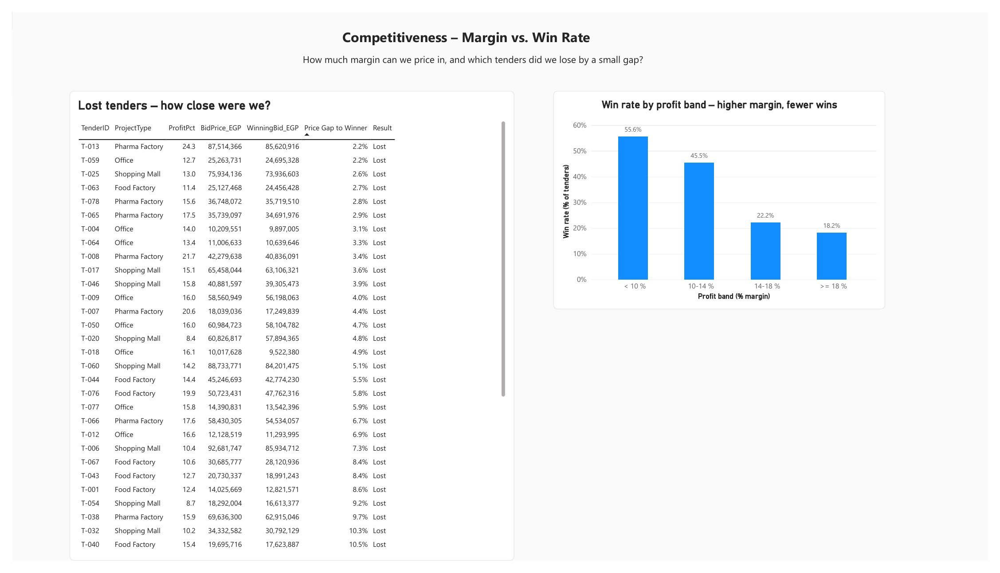
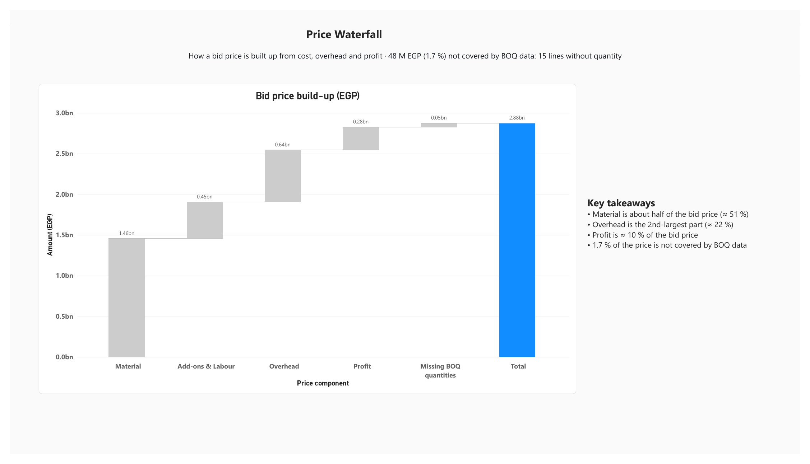
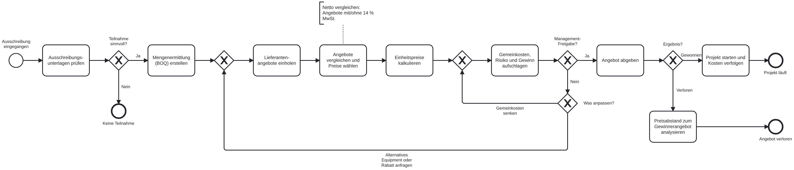

# Tender Pricing Dashboard (Power Query + Power BI)

A Power BI dashboard for **MEP tender pricing and project cost controlling** (HVAC, plumbing, fire fighting).
It is modelled on my own tender-pricing workflow from 7+ years as a technical office engineer in Egypt:
quantity take-off → supplier quotes → dry cost → overhead % → profit % → bid → won/lost → project execution.

**All data is fictional.** It is generated with `generate_data.py` (Python, seed 42). No real company, client or supplier data is used.

## Key findings

- Win rate is **35 %** overall and **50 %** in 2019. Low margins win more often: **55.6 %** below 10 % profit vs. **18.2 %** at 18 % and more.
- Lost tenders were on average **8.7 %** more expensive than the winning bid.
- Material is about **half of the bid price**. **48 M EGP (1.7 %)** of the bid value is not covered by BOQ data, because **15 BOQ lines have no quantity** (a data-quality finding, see below).
- Executed projects cost **6.6 %** more than planned (reporting date 30 Jun 2020). **10 of 28** projects are more than 10 % over budget; **HVAC** has the highest overrun (8.8 %), linked to the 2016 EGP devaluation.

## Dashboard pages

| Page | Question it answers |
|---|---|
| **Summary** | What are the key results across pricing and execution? (2 KPI visuals, key numbers, findings) |
| **Project Cost Controlling** | Are executed projects on budget? Budget vs. actual vs. forecast at completion, overrun per system |
| **Cost & FX Risk** | Who pays when the USD/EGP rate moves? Escalation clause scenario with threshold |
| **Overview** | How many tenders do we win, at what margin and volume? Year-over-year win rate |
| **Competitiveness** | How much margin can we price in, and which tenders did we lose by a small gap? |
| **Price Waterfall** | How is a bid price built up from material, add-ons & labour, overhead and profit? |

## Data-quality finding: reconciling the price waterfall

The first version of the waterfall ended at **2.83 bn EGP**, while the total bid value is **2.88 bn EGP**.
I traced the gap back to the source script: the bid prices were calculated from the complete BOQ, but about 2 % of BOQ quantities were deleted afterwards to simulate messy data.
The **15 lines without quantity** are worth **48.07 M EGP** including overhead and profit; the remaining 0.04 M EGP is rounding.
Instead of hiding the gap, the waterfall shows it as its own step ("Missing BOQ quantities"), so it reconciles exactly to the official total.

## How it was built

1. **Data generation** (`generate_data.py`): 80 tenders 2013–2019, BOQ items, supplier quotes (with and without 14 % VAT), monthly USD/EGP rates, and monthly cost data for 28 executed projects. The data is deliberately messy: different spellings, units and date formats, prices as text, missing values and duplicates.
2. **Cleaning with Power Query** (`tender_cleaning.xlsx` and Power BI): removing duplicates, standardising Won/won/WON, item names and units, fixing date formats, converting all quotes to net prices.
3. **Data model in Power BI**: fact tables (tenders, BOQ items, supplier quotes, project costs) with a marked Calendar date table and a project dimension.
4. **DAX measures**, for example:
   - win rate, win rate last year (`SAMEPERIODLASTYEAR`) and change in percentage points
   - average price gap to the winning bid for lost tenders
   - cumulative planned vs. actual cost, forecast at completion, overrun %
   - escalation amount per contract: `W × factor × (X2 − X1) / X1` with factor 0.75 for imported and 0.65 for local items, only above a contract threshold
   - waterfall steps with a reconciliation step for missing BOQ data

## Process model (BPMN 2.0)

*Click the image to open it in full size.*

This is my first BPMN 2.0 model. I drew the tender process I know from my work as head of a technical office, in German, with the free modeller [demo.bpmn.io](https://demo.bpmn.io). The dashboard analyses the results of this process; the diagram shows how a bid comes about.

**What the model shows**
- A tender arrives, is checked, and a first decision is made: is it worth taking part (*Teilnahme sinnvoll?*).
- Quantity take-off (BOQ), supplier quotes, comparison on a net basis (quotes come with or without 14 % VAT), unit prices, then overhead, risk and profit.
- **Management approval loop:** if the bid is not approved, the question is what to change. Either the overhead is reduced, or alternative equipment or a discount is requested from suppliers, and the process goes back to the matching step.
- After submission the result decides the path: *won* leads to project start and cost tracking, *lost* leads to the analysis of the price gap to the winning bid.

**How it connects to the dashboard**
- The *Competitiveness* page (win rate, price gap to the winning bid) analyses the step *Ergebnis?* and the lost-tender path.
- The *Project Cost Controlling* page covers *Projekt starten und Kosten verfolgen*.
- The *Price Waterfall* page shows how the steps from unit prices to overhead and profit build up the bid price.

**BPMN elements used:** start and end events, tasks, exclusive gateways (decisions and merges), sequence flows, a text annotation.

**Limits:** one process in one pool, no swim lanes (who does what), simplified from memory of a real workflow. No real company data. The editable source is `Tender_Prozess.bpmn`; it can be opened in demo.bpmn.io.

## Files

| File | Content |
|---|---|
| `Tender_Pricing_Dashboard.pbix` | Power BI file (open with Power BI Desktop) |
| `Tender_Pricing_Dashboard.pdf` | All 6 pages as PDF, no Power BI needed |
| `images/` | Screenshots of each page |
| `generate_data.py` | Fictional data generator (Python, standard library only) |
| `data_raw/` | Generated raw CSV files |
| `tender_cleaning.xlsx` | Power Query cleaning steps |
| `Tender_Prozess.bpmn` | BPMN 2.0 model of the tender process (editable in demo.bpmn.io) |
| `Tender_Prozess.png`, `.svg` | The same model as an image |

## Next steps

- **New USD rate input:** enter today's rate (about 54 EGP per USD, Central Bank of Egypt, Nov 2026) and calculate the escalation per contract with its own tender-date rate (X1).
- **Open tender 2026:** price a new tender at the current exchange rate with an FX contingency.
- **Power Automate:** a flow that collects new supplier quote files and refreshes the data.
- **SQL:** reproduce the key measures as SQL queries on the raw CSV files.

## About me

Shimaa Ismail, M.Sc. Data Science student (AI) at FAU Erlangen-Nürnberg, with a background in tender pricing and cost estimation for MEP projects.
